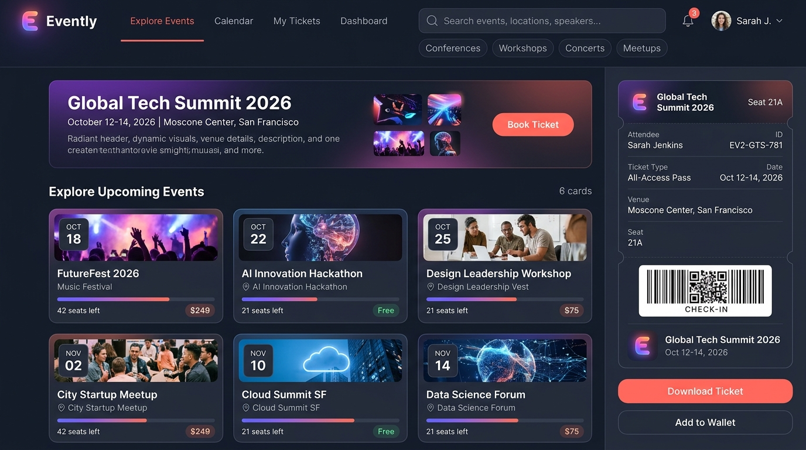
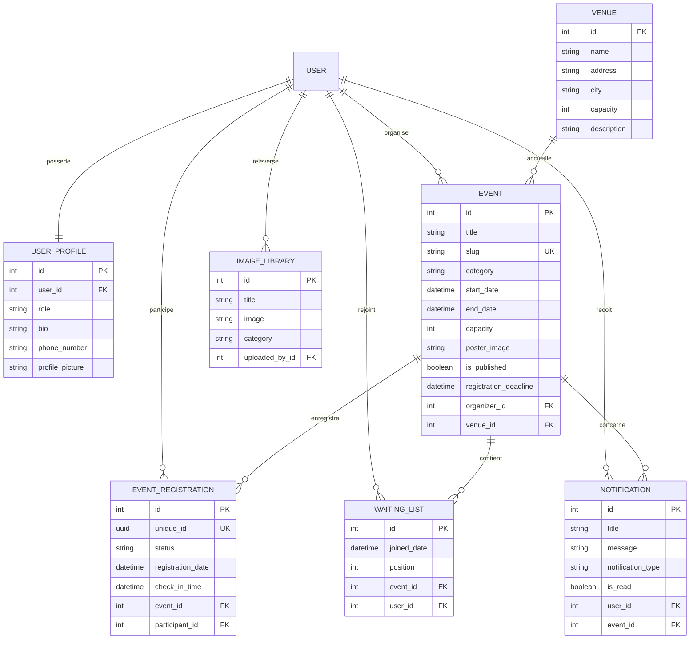

# 🎪 Evently V2 — Plateforme Web Complète de Gestion d'Événements & Billetterie

<p align="center">
  
  
  
  
  
  
</p>

<p align="center">
  
</p>

---

## 📌 Présentation du Projet

**Evently V2** est une application web moderne et responsive développée avec **Django 5** et **Bootstrap 5**, dédiée à la découverte, la planification, la publication et la gestion intégrale d'événements (conférences technologiques, ateliers, séminaires, concerts et meetups).

Elle offre une expérience fluide tant pour les **organisateurs** (gestion de jauges de places, validation de lieux, personnalisation des affiches et suivi des inscriptions) que pour les **participants** (réservation instantanée, gestion de liste d'attente automatique et génération de billets PDF personnalisés avec QR Code unique pour l'émargement physique).

---

## 📸 Aperçu & Interface Utilisateur

<p align="center">
  
  <br />
  <em>Interface Evently V2 : Exploration d'événements avec filtres catégoriels, jauges de places en temps réel et pass de billetterie numérique avec QR code.</em>
</p>

---

## 🌟 Fonctionnalités Clés

### 👥 1. Gestion des Utilisateurs & Rôles
- **Système d'authentification complet** : Inscription, connexion, déconnexion sécurisée et réinitialisation de mot de passe par e-mail.
- **Rôles applicatifs dédiés** :
  - **Administrateur** : Supervision globale, gestion des rôles utilisateurs et modération des médias.
  - **Organisateur** : Création d'événements, gestion des lieux et suivi des participants inscrits.
  - **Participant** : Consultation du catalogue, inscription aux événements et téléchargement des billets.
- **Profil enrichi (`UserProfile`)** : Photo de profil, biographie, numéro de téléphone et rôle attribué.

### 🎪 2. Gestion Avancée des Événements
- **Cycle de vie complet (CRUD)** : Création, consultation détaillée, mise à jour et suppression sécurisée.
- **Catégorisation & Recherche** : Filtrage par type (*Conférence*, *Workshop*, *Meetup*, *Séminaire*, *Autre*) et recherche textuelle.
- **Validation temporelle stricte** : Contrôle automatique des dates (la date de fin doit être postérieure à la date de début ; date limite d'inscription configurable).
- **URLs conviviales (Slugs)** : Navigation et référencement optimisés avec slugs uniques.
- **Gestion des visuels** : Téléversement d'affiches personnalisées et bibliothèque multimédia d'images réutilisables (`ImageLibrary`).

### 🎟️ 3. Billetterie Numérique & QR Code
- **Génération de Billets PDF** : Édition automatisée de tickets prêts à l'impression avec **ReportLab**.
- **Check-in par QR Code** : Chaque inscription génère un identifiant unique `UUID` encodé sous forme de QR Code via **qrcode**, facilitant le contrôle d'accès le jour de l'événement.
- **Gestion des jauges & Liste d'attente** :
  - Calcul dynamique des places disponibles (`available_seats`).
  - Bascule automatique sur **Liste d'attente (`WaitingList`)** dès saturation de la capacité maximale.

### 🏢 4. Gestion des Lieux (Venues)
- Répertoire des salles et complexes avec adresse postale, ville et capacité maximale d'accueil.
- Liaison directe entre les événements et leurs lieux respectifs.

### 📊 5. Tableau de Bord d'Administration Personnalisé
- Vue d'ensemble sur `dashboard/` permettant à l'administrateur de mettre à jour les rôles des utilisateurs sans passer systématiquement par l'administration brute Django.
- Gestionnaire de médiathèque intégré pour téléverser et associer rapidement des visuels.

---

## 🏗️ Modèle de Données (Mermaid ERD)



---

## 📂 Structure du Répertoire

```
evently/
├── evently/                          # Configuration du projet Django
│   ├── settings.py                   # Paramètres (Apps, DB SQLite/MySQL, Static, Media)
│   ├── urls.py                       # Routage principal
│   └── wsgi.py
├── events/                           # Application principale
│   ├── models.py                     # Modèles : Event, Venue, Registration, WaitingList, Profile
│   ├── views.py                      # Vues principales (Home, EventListView, Detail, Auth)
│   ├── views_event_management.py     # Logique métier (Réservation, Billets PDF, CRUD Événements)
│   ├── admin_views.py                # Dashboard admin et gestion des rôles
│   ├── forms.py                      # Formulaires de saisie et de validation
│   ├── urls.py                       # Définition des routes locales
│   └── admin.py                      # Enregistrement dans l'admin Django
├── templates/                        # Templates HTML Bootstrap 5
│   ├── base.html                     # Squelette principal avec barre de navigation moderne
│   ├── home.html                     # Page d'accueil avec vitrine et événements récents
│   └── events/                       # Vues d'événements, profils, billetterie et dashboard
├── static/                           # Fichiers statiques (CSS, JS, Logos, Bannières)
│   ├── css/                          # Feuilles de style personnalisées & animations
│   ├── js/                           # Scripts front-end
│   └── images/                       # Éléments graphiques (bannières, profils, logos)
├── media/                            # Fichiers médias téléversés (affiches, avatars)
├── docs/
│   └── screenshots/                  # Visuels et captures d'écran de démonstration
│       ├── evently_banner.png        # Bannière héro du projet
│       └── evently_dashboard.png     # Mockup de l'interface utilisateur
├── manage.py                         # Utilitaire de commande Django
├── requirements.txt                  # Dépendances Python
└── .gitignore                        # Fichier d'exclusion Git
```

---

## 🚀 Installation & Démarrage Rapide

### 1. Prérequis
- **Python** (version 3.10 ou supérieure)
- **pip** (gestionnaire de paquets Python)

### 2. Cloner le Projet & Créer l'Environnement Virtuel

```bash
# Cloner le dépôt
git clone https://github.com/LibrarianPoms/Evently-V2---Events-Manager-website-with-Django.git
cd Evently-V2---Events-Manager-website-with-Django

# Créer un environnement virtuel
python -m venv venv

# Activer l'environnement
# Sous Windows :
venv\Scripts\activate
# Sous Linux / macOS :
source venv/bin/activate
```

### 3. Installer les Dépendances

```bash
pip install -r requirements.txt
```

### 4. Appliquer les Migrations

Le projet est configuré par défaut avec **SQLite** pour un démarrage immédiat avec les données de démonstration préexistantes :

```bash
python manage.py migrate
```

*(Optionnel)* Si vous préférez utiliser **MySQL**, décommentez le bloc `DATABASES` dans `evently/settings.py` et spécifiez vos identifiants de connexion.

### 5. Créer un Compte Administrateur (Superuser)

```bash
python manage.py createsuperuser
```

### 6. Lancer le Serveur de Développement

```bash
python manage.py runserver
```

Rendez-vous sur **http://127.0.0.1:8000/** dans votre navigateur pour découvrir la plateforme !

---

## 🗺️ Cartographie des Principales Routes

| URL | Méthode | Description | Accès Requis |
|---|---|---|---|
| `/` | `GET` | Page d'accueil & vitrine des événements | Public |
| `/events/` | `GET` | Catalogue complet des événements avec filtres | Public |
| `/events/<slug>/` | `GET` | Fiche détaillée d'un événement | Public |
| `/register/` | `GET, POST` | Inscription nouvel utilisateur | Public |
| `/login/` | `GET, POST` | Connexion utilisateur | Public |
| `/profile/` | `GET, POST` | Profil utilisateur et historique des réservations | Authentifié |
| `/create-event/` | `GET, POST` | Formulaire de création d'événement | Organisateur / Admin |
| `/events/<slug>/register/` | `POST` | Réservation d'une place pour un événement | Authentifié |
| `/registration/<id>/ticket/` | `GET` | Téléchargement du billet PDF avec QR Code | Titulaire / Admin |
| `/dashboard/` | `GET` | Tableau de bord de gestion & rôles utilisateurs | Administrateur |

---

## 📄 Licence

Ce projet est sous licence **MIT**. Libre d'utilisation, de modification et de distribution dans le cadre de vos projets académiques et professionnels.
